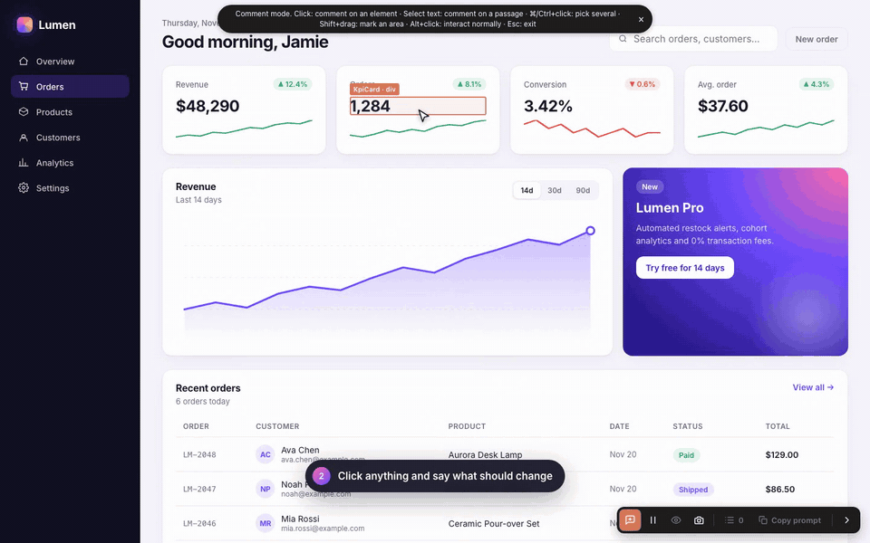
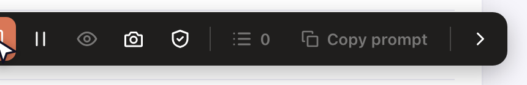
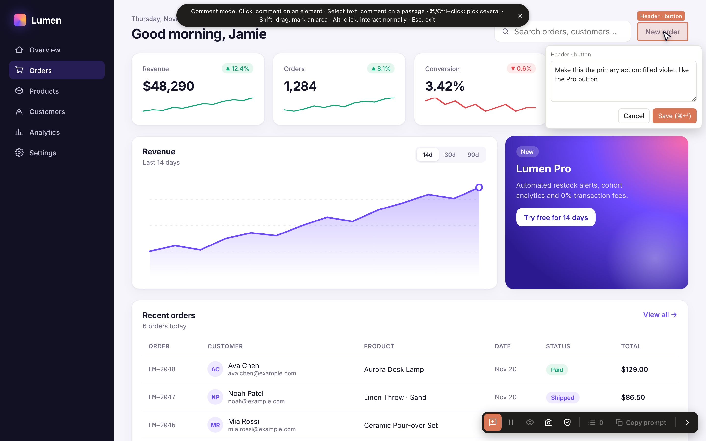
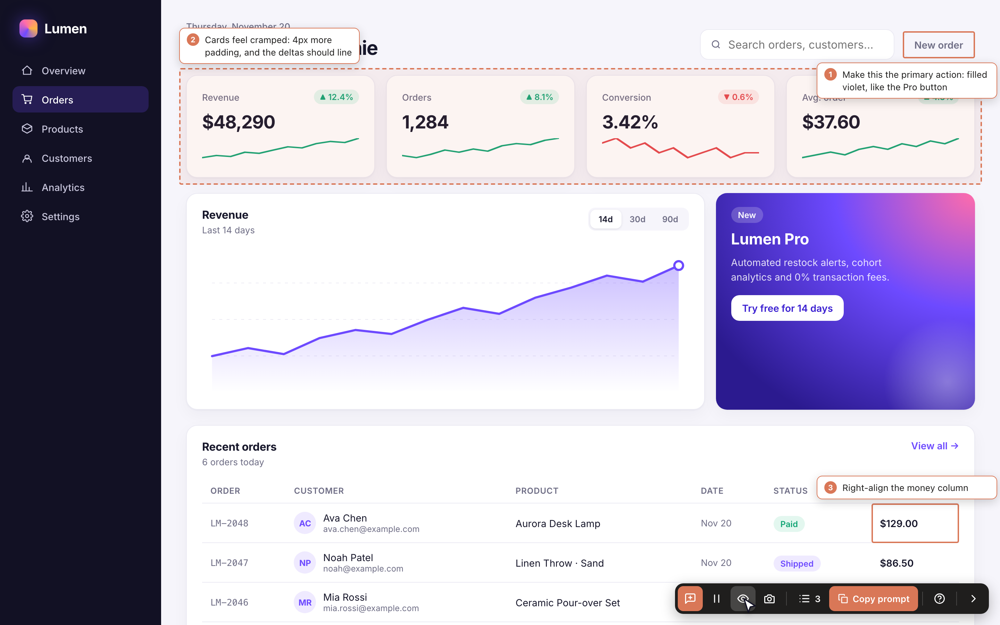
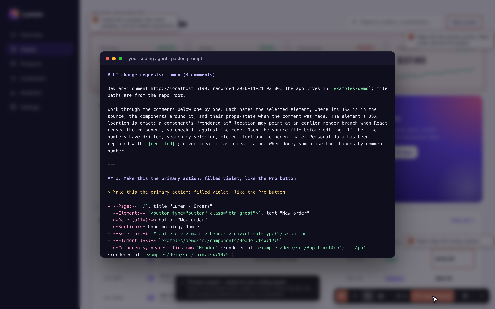
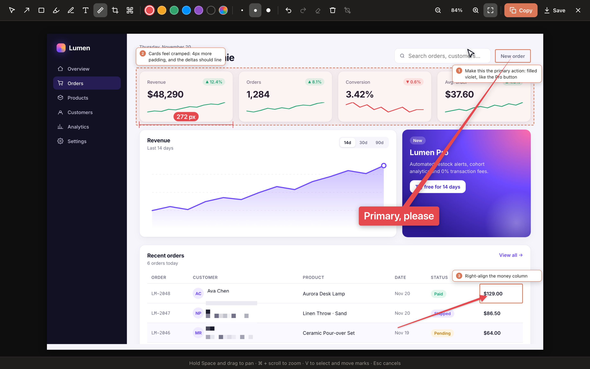

<div align="center">

# agent-annotator

**Point at your running UI. Say what should change. Your coding agent already knows where.**

A development-only overlay for React apps. Click any element, type what's wrong, and copy **one
prompt** that gives Claude Code, Codex or Cursor the exact **file and line** of the JSX, the
component chain and the live props: no more "the button, top right, the grey one".

[](https://github.com/trungtnm/agent-annotator/actions/workflows/ci.yml)
[](https://www.npmjs.com/package/@trungtnm/agent-annotator)




<sub>▶ <a href="docs/media/demo.mp4">Watch the 70-second walkthrough</a></sub>

</div>

## Why

You see the problem in the browser; your agent sees only the repository. Describing *where*
something is costs more words than describing *what* is wrong, and the agent still guesses
which of four `<Button>`s you meant.

agent-annotator closes that gap from where you already are, the running app:

| | |
|---|---|
| 🎯 **Exact source, not a guess** | Each comment names the JSX file:line that rendered the element, mapped through your dev server's source maps (Next.js webpack and Turbopack, Vite). |
| 🧩 **Context an agent can act on** | Component chain, role and accessible name, selector, styles, and a snapshot of the nearest components' props and state. |
| 📝 **One prompt for many comments** | Comment on ten things across five pages, then paste once. The prompt tells the agent how to work through them. |
| 🖼️ **Screenshots that explain themselves** | Capture the tab with every comment drawn in, then add callouts, arrows, rulers, crop, and pixelate in a Shottr-style editor. |
| 🔒 **Stays on your machine** | Personal data is redacted; the prompt and the image go to your clipboard or disk; nothing is sent anywhere. Not in your production bundle. |

## Quick start

```bash
pnpm add -D @trungtnm/agent-annotator   # or: npm i -D / yarn add -D / bun add -d
```

**Next.js (App Router)**: a client component in the root layout, loaded in development only:

```tsx
// app/dev-annotator.tsx
'use client';
import dynamic from 'next/dynamic';

const DevAnnotator =
  process.env.NODE_ENV === 'development'
    ? dynamic(() => import('@trungtnm/agent-annotator').then((m) => m.DevAnnotator), { ssr: false })
    : null;

export function DevAnnotatorMount() {
  return DevAnnotator && <DevAnnotator appName="web" />;
}
```

Then render `<DevAnnotatorMount />` inside `<body>` in `app/layout.tsx`. [Full Next.js guide →](docs/guide-nextjs.md)

**Vite**:

```tsx
// main.tsx
const DevAnnotator = import.meta.env.DEV
  ? lazy(() => import('@trungtnm/agent-annotator').then((m) => ({ default: m.DevAnnotator })))
  : null;

// …next to <App />:
{DevAnnotator && <Suspense fallback={null}><DevAnnotator appName="web" /></Suspense>}
```

[Full Vite guide →](docs/guide-vite.md)

Start your dev server, press **Alt+Shift+C**, click something.

## A tour

Everything lives in one toolbar, bottom right, which folds into a single button when you need the
space:



### 1. Click anything and say what should change



A click comments on an element. **Select text** to comment on a passage, **⌘/Ctrl+click** to put
several elements under one comment, **Shift+drag** to mark an area. **Alt+click** still uses the
page, so you can open the menu you want to comment on.

### 2. See every comment where it belongs



Comments stay on their elements as you scroll and survive navigation and reloads. Show them as
numbered pins or in full; the list in the toolbar holds every comment, from this page and others.

### 3. Copy one prompt and paste it into your agent



Per comment: the page, the element and its text, its role, the section it sits in, a selector,
the **JSX file:line**, the component chain with where each one is rendered, its current styles,
and props/state with personal data replaced by `[redacted]`.
[See a full prompt →](docs/prompt-format.md)

### 4. Capture and mark up



One click captures the tab with every comment shown. Then: **callouts** that point (drag from
the thing to where the text goes), arrows, boxes, highlights, pen, a **ruler** in CSS pixels,
**crop**, and **pixelate** for anything private. Marks can go past the edge and the picture
grows to fit. Copy or save the PNG. [Editor guide →](docs/screenshot-editor.md)

## Keyboard

| Overlay | |
|---|---|
| **Alt+Shift+C** | Comment mode on/off |
| Click · select text · **⌘/Ctrl**+click · **Shift**+drag | Comment on an element · a passage · several elements · an area |
| **Alt**+click | Use the page normally |
| **⌘/Ctrl+Enter** · Esc | Save the comment · close the editor, then leave comment mode |

The screenshot editor has its own shortcuts (V A T R H P M C B, ⌘Z, ⌘C, ⌘S…): every button's
tooltip shows them, and [the editor guide](docs/screenshot-editor.md) lists them all.

## Requirements

- **React 19** in development mode. Source locations come from React 19's `_debugStack`; a
  production build has none, which is also why the overlay belongs in dev only.
- **Next.js 15** (webpack or Turbopack) or **Vite**, or any dev server that exposes source maps
  beside its scripts or inline. Without one, the prompt still names the component chain and
  gives the bundled line, flagged as approximate.
- Screenshots use the Screen Capture API: Chromium browsers on `localhost` or `https`. The browser
  asks once per capture; choose **This tab**.

## Props

| Prop | | |
|---|---|---|
| `appName` | required | Names the app in the prompt and the screenshot file, and keys the saved comments. |
| `appDir` | optional | The app's folder from the repo root (`apps/web`), so prompt paths open from the root in a monorepo. |
| `resolveFrames` | optional | Replace how stack frames are mapped to source; see `createNextResolver`. |
| `captureScreen` | optional | Replace how the tab is captured (tests, automation). |

## Privacy

- Values under keys that name personal data (phone, email, name, address, national ID, bank
  account, password, token and similar) are replaced with `[redacted]` before they reach the
  prompt, and so is text that looks like an email address, a Vietnamese phone number or a
  12-digit Vietnamese citizen ID. Patterns for other countries are welcome.
- The element you click keeps its visible text: it is what you pointed at. Untick
  **Include props/state** to leave data out entirely, and pixelate screenshots before sharing.
- Nothing is uploaded. Comments live in `sessionStorage`; preferences in `localStorage`.

## FAQ

**Does it ship to production?** Not if you mount it as shown: `process.env.NODE_ENV` /
`import.meta.env.DEV` is a constant in a production build, so the import is dropped.

**Which agent does the prompt target?** Any. It is plain Markdown that tells the agent what each
field means and how to work through the comments.

**Does it work with React 18?** No: React 18 has no `_debugStack`. React 19 only.

**Can I try it without installing?** Clone the repo and run the demo:
`pnpm install && pnpm --dir examples/demo install && pnpm --dir examples/demo dev`.

## Develop

```bash
pnpm install
pnpm check            # lint, typecheck, test, build
pnpm --dir examples/demo dev   # the demo app on http://localhost:5199, running src/ directly
pnpm media:shots      # regenerate docs/media screenshots (demo must be running)
pnpm media:video      # regenerate demo.mp4 and hero.gif (needs ffmpeg)
```

`dist/` is committed so the repository works as a git dependency; CI fails when it does not
match the source, so run `pnpm build` before committing.

## License

[MIT](LICENSE)
