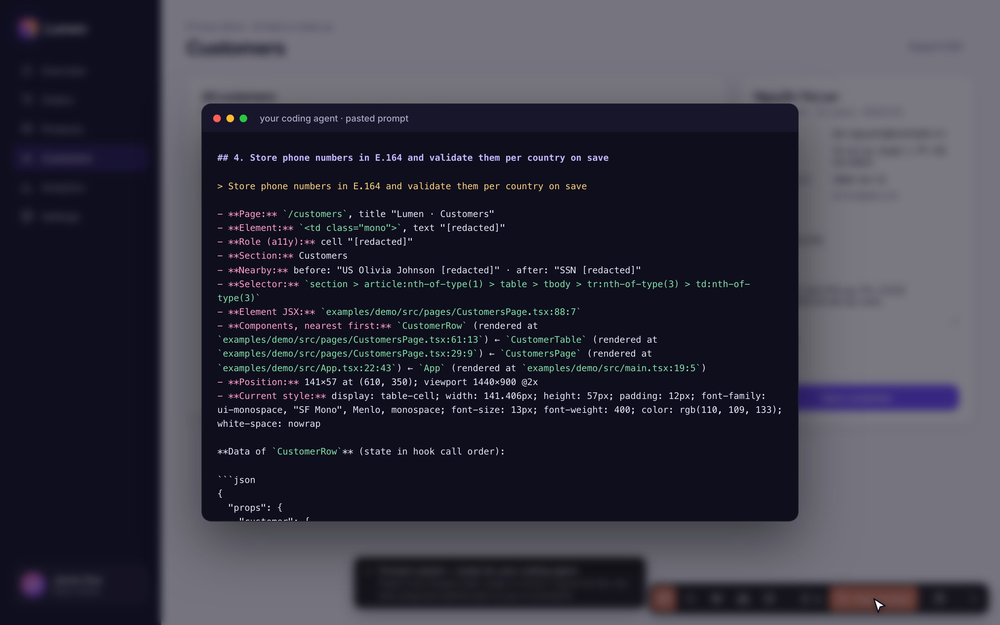

# Personal data redaction

The prompt is pasted into an AI agent, so anything it carries leaves your machine. A dev
database often holds copies of real customer data, so agent-annotator screens every
capture before it is stored. That covers the props and state snapshots, element text and
attributes, form values, the selected passage, and the section and nearby labels.



The demo's **Customers** page (`pnpm --dir examples/demo dev`, then
http://localhost:5199/customers) contains made-up customers from all three countries, so you
can try every setting there.

## What is screened

| Screen | Applies to | Built-in |
|---|---|---|
| **By key** | A property whose name says it holds personal data or a secret. Its whole value becomes `[redacted]`, but an empty value (`null`, `''`) is kept, because "the phone is missing" can be the bug. | phone, mobile, email, full name, *debtor/customer/contact…* name, address, date of birth, national/citizen ID, passport, bank account, card number, password, secret, token, OTP, API key, authorization, cookie, signature |
| **By value** | Any match inside any string, wherever it appears. | e-mail addresses |
| **Country formats** | Value patterns, plus a few key names, for each selected country. | see below |
| **Your patterns** | Value patterns you write. | none |

Keys are compared lower-cased with `_`, `-` and spaces removed, so `phoneNumber`,
`phone_number` and `Phone Number` all match.

### Countries

| Country | Values | Extra keys |
|---|---|---|
| **Vietnam** (`vn`, the default) | Phone numbers starting `0`, `84` or `+84`, optionally grouped by spaces or dots; 12-digit citizen IDs (CCCD) | `cccd`, `cmnd`, `zalo` |
| **United States** (`us`) | NANP phone numbers: `(415) 555-0132`, `+1 415.555.0132`, `4155550132`; Social Security numbers written with dashes (`123-45-6789`), excluding the never-issued ranges | `ssn` at either end of the key, `socialSecurity` |
| **Singapore** (`sg`) | NRIC/FIN numbers (`S1234567D`); phone numbers starting 3, 6, 8 or 9 when written with `+65` or split `9123 4567` / `9123-4567` | `nric` |

Amounts are left alone on purpose, because they are usually what a UI bug is about. Each
built-in number pattern needs a shape that no money figure has: a leading `0` or country
code, a separator, or letters around the digits. This means a bare 8-digit Singapore number
(`91234567`) and an undashed SSN are **not** caught by value. Under a key such as `phone` or
`ssn` they are still redacted whole. Add a pattern of your own if your data holds them in
free text.

### Your own patterns

Write one regular expression per line, either as a bare source (`INV-\d{6}`) or as a
literal with flags (`/acct[0-9]+/i`). The `g` flag is always added. A pattern that does not
compile, or that matches empty text (which would put `[redacted]` between every
character), is skipped, and the settings panel shows the reason.

## Turning it off

With the switch off, new comments carry props, state and page text exactly as the page
shows them. The only exception is password inputs, whose values are never copied.

## Settings

### In the browser

The **shield** button on the toolbar opens the settings. It changes to a crossed-out
shield when redaction is off. The panel has:

- **Redact personal data**, the on/off switch;
- **Number formats**, one checkbox per country;
- **Your own patterns**, a textarea with one pattern per line;
- **Use app defaults**, which drops this browser's settings and goes back to the
  `redaction` prop.

Settings are saved in `localStorage` under `agent-annotator:redaction:<appName>`, so each
app and each browser keeps its own.

### In code

Set the defaults every browser starts from with the `redaction` prop:

```tsx
<DevAnnotator
  appName="web"
  redaction={{
    enabled: true,            // default true
    countries: ['vn', 'us'],  // default ['vn']
    patterns: ['INV-\\d{6}', /acct\d+/i],  // default []
  }}
/>
```

Any field you leave out keeps its default. A `RegExp` is shown in the panel as
`/source/flags`. Settings saved in a browser take precedence over the prop until you press
**Use app defaults**.

## Settings apply to new comments only

Each comment is screened when you make it, and the comment stores only the screened
result. Changing the settings later does not change comments already made, and turning
redaction back on cannot hide data that a comment recorded while it was off. The prompt
says exactly which comments were recorded with redaction off; see
[the prompt format](prompt-format.md).

## Contributing a country

Each country is an entry in `COUNTRY_RULES` in [`src/redaction.ts`](../src/redaction.ts),
with a label, a one-line description, key patterns and value patterns. Add tests to
`src/redaction.test.ts` covering both the numbers it must catch and amounts and dates it
must leave alone.
