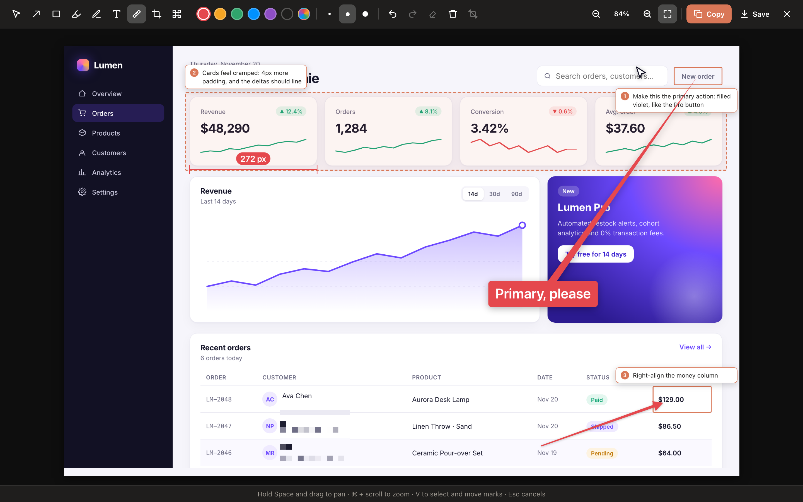

# Screenshot editor

The camera button in the toolbar captures the tab with every comment drawn in full, then opens
the editor. The browser asks which tab to share on each capture; choose **This tab** (Chromium, on
`localhost` or `https`).

## Tools

| Key | Tool | |
|---|---|---|
| **V** | Select & move | Click a mark to select it, drag to move it, arrow keys nudge (Shift: 10px), ⌫ deletes. Changing the colour or weight changes the selected mark. |
| **A** | Arrow | Hold Shift to snap to 45°. |
| **T** | Callout | Press on what you mean and drag to where the text goes: one box with a tail. A click gives a box without one. Enter places it, Shift+Enter adds a line. Double-click a callout to edit it; drag its round grip to re-aim the tail. |
| **R** | Rectangle | Hold Shift for a square. |
| **H** | Highlight | A translucent marker. |
| **P** | Pen | Freehand. |
| **M** | Ruler | Measures in the page's own CSS pixels (the capture is divided by the device pixel ratio). Shift keeps it straight. |
| **C** | Crop | Applied on release; undo or **Reset crop** brings the rest back. |
| **B** | Pixelate | Samples the original pixels, so stacking pixelations never smears. |
| **1 2 3** | Weight | Thin, medium, thick: stroke, arrowhead and text size together. |

Six preset colours plus a free colour picker.

## Beyond the edge

Draw on the dark board around the picture, or drag a mark out of it: the picture grows to hold
it, filled with the colour found along the capture's edge, so the extension reads as more page.

## View

| | |
|---|---|
| ⌘+ / ⌘− | Zoom in / out |
| ⌘0 · ⌘1 | Fit to window · actual size |
| ⌘ + scroll, pinch | Zoom at the pointer |
| Space + drag | Pan |

## History and output

| | |
|---|---|
| ⌘Z · ⇧⌘Z | Undo · redo (marks and crop) |
| ⌘C | Copy the PNG to the clipboard |
| ⌘S | Save as `<app>-<page>-<date>-<time>.png` |
| Esc | Cancel what is in progress (never closes the editor) |
| Close | Asks before discarding marks not yet copied or saved |
